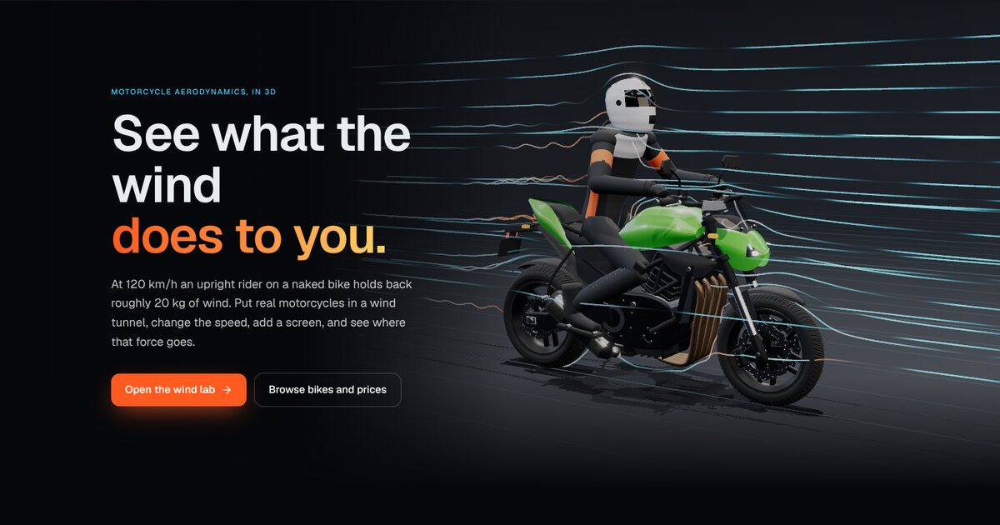
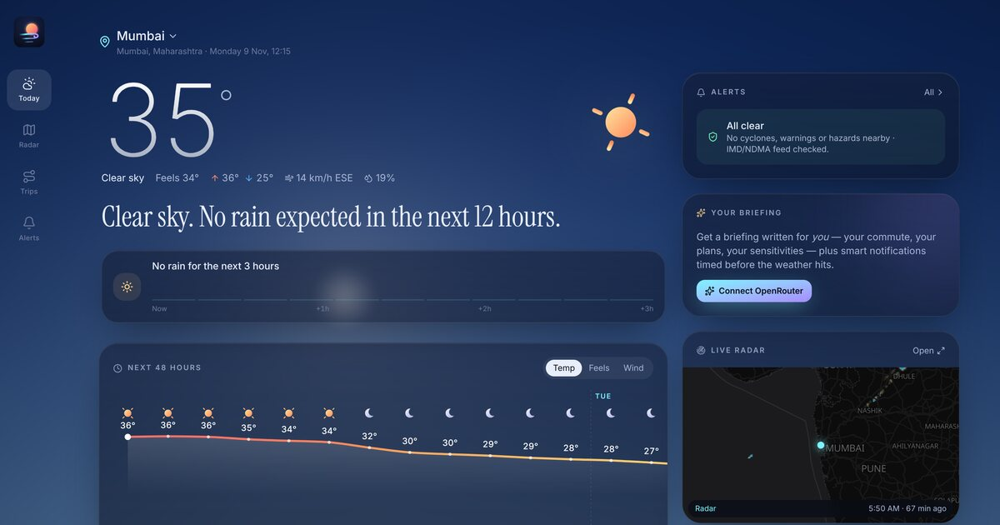
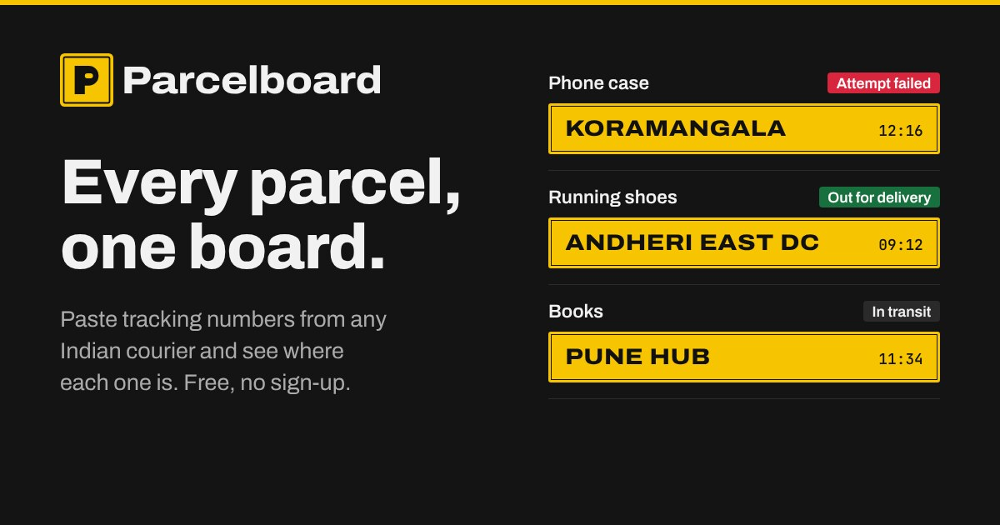
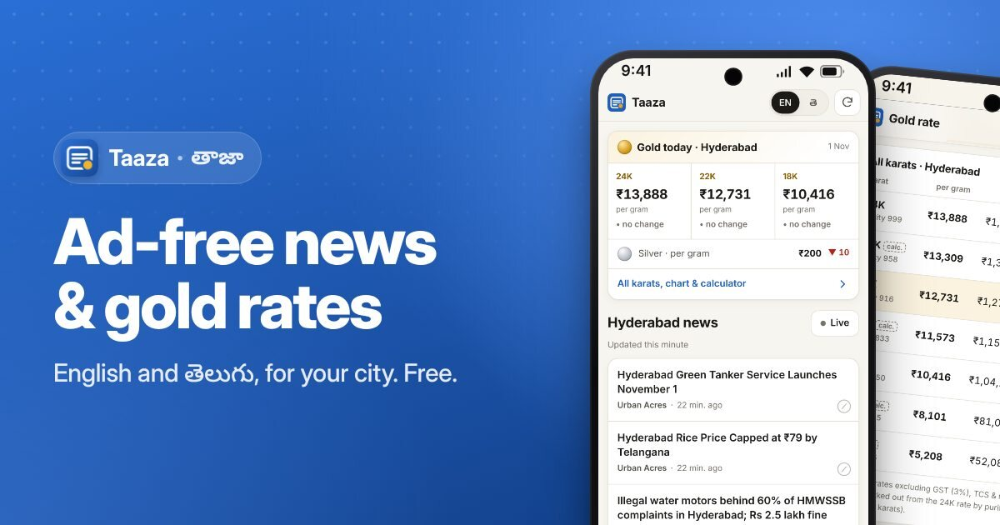
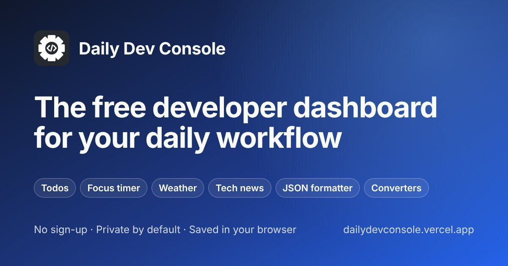
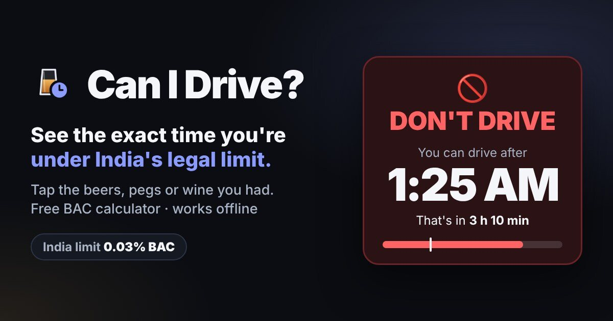
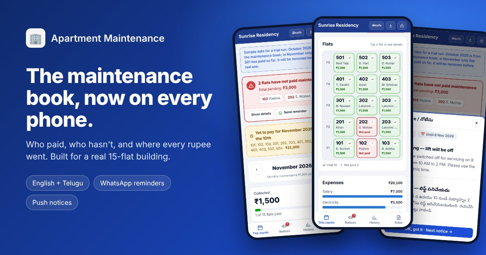

<h1 align="center">Hi 👋, I'm Pavan Kalyan Neerukonda</h1>
<h3 align="center">Powered by chai, Claude and petrol.</h3>

<i>Full Stack Engineer · AI Tinkerer · Motorbike Rider</i>

  
  
  

### 💫 About Me
I'm a Full Stack Engineer who turns ideas into fast, reliable, user-friendly software. Today that means pairing solid engineering fundamentals with AI: shipping LLM-powered features, automating the boring parts with AI agents, and using AI coding tools to move from idea to production faster without compromising on quality.

I care about the craft: clean architecture, great UX, and software that genuinely makes people's lives easier.

Outside of tech, I love long motorbiking trips, good books and podcasts, tinkering with gadgets and home automation, and connecting with people.

- 🚀 Shipped **8 free, installable web apps**, from loan maths to a 3D motorcycle wind tunnel. [See them below ↓](#-things-ive-built)
- 🤖 Currently exploring **LLM apps, AI agents, RAG and the Model Context Protocol (MCP)**
- 🛠️ Building across the stack with **Angular, React, Next.js, Node.js, AWS and GCP**
- 👨‍💻 All my projects live in my [GitHub repos](https://github.com/pavan-98?tab=repositories)
- 📝 I write about tech on [LinkedIn](https://www.linkedin.com/in/pavan-kalyan-neerukonda/recent-activity/articles/)
- 💬 Ask me about **Full Stack Development, Cloud Architecture, Front End Performance and building with AI**
- 📫 Reach me at **pavan@npavankalyan.com** or on [LinkedIn](https://www.linkedin.com/in/pavan-kalyan-neerukonda)
- ⚡ Fun fact: **I love motorbiking**

---

## 🚀 Things I've Built

Real products for real people: designed, built and shipped end to end. Every one is **free**, needs **no sign-up**, keeps your data **on your device**, and installs on your phone like a native app.

 

### 💸 [LoanSense](https://loansense.in): see what your loan *really* costs

> A ₹50 lakh home loan at 8.5% for 20 years costs **₹54 lakh in interest**, more than you borrowed. Most EMI calculators stop at the EMI. LoanSense shows you the rest, and how to cut it.

- 🏦 **8 loan types:** home, car, two-wheeler, personal, education, gold, loan-against-property and business
- 📉 **Plan your way out of debt:** prepayment planner, debt-free-by-a-date goals, prepay vs invest, and what an RBI repo-rate change does to your EMI
- ⚖️ **Never sign a bad deal:** compare up to 3 offers ranked by the *true* rate including fees, unmask "flat" dealer rates, test a balance transfer and check eligibility
- 📒 **My Loans:** a private tracker for the loans you already have, with reminders and a financial-year interest breakdown for tax time
- 📄 **Detailed PDF reports** and shareable plan links (WhatsApp-ready), in **English, हिन्दी, தமிழ், తెలుగు, മലയാളം, ಕನ್ನಡ and বাংলা**
- 🤖 **Works inside AI assistants:** a public **MCP server** lets Claude, ChatGPT, Cursor and VS Code run exact Indian loan maths

  
  

 

### 🏍️ [Windblast Lab](https://windblast-lab.vercel.app): a 3D wind tunnel for motorcycles

> At 120 km/h an upright rider on a naked bike holds back roughly **20 kg of wind**. Windblast Lab puts real motorcycles in a wind tunnel so you can see exactly where that force goes. Built by a rider, for riders.

- 🌬️ **Interactive 3D wind lab:** rotate the bike and rider, change speed and crosswind, and watch smoke lines, particles and a pressure map flow over them
- 📊 **Live physics readouts:** force on each part of your body, drag, power, top speed, range and helmet buffeting
- 🛡️ **Try before you buy:** fit a touring screen, deflector, handguards, luggage or crash bars and compare against the stock bike
- 🧠 **Any bike, built by AI:** not in the catalogue? AI builds a 3D model from its published dimensions
- 🇮🇳 **Bike encyclopedia** with specs, side-by-side comparison and **state-wise on-road prices for India**
- 🔗 Share a setup as a link, or export the 3D model as `.glb`

  
  
  

 

### 🌤️ [Aether Weather](https://aether-weather.nrkpavan.workers.dev): the AI-native weather app

> Weather that knows your commute. Aether combines 7 global forecast models, India's official alerts and an AI that writes your briefing, built India-first and works worldwide.

- ✨ **A living sky:** a WebGL backdrop renders the *actual* conditions where you are: sun position, clouds, rain, fog and lightning
- 🛰️ **Radar that looks ahead:** observed radar flows straight into **48 hours of forecast rain**, with wind particles and NASA satellite imagery
- 🌀 **Cyclone tracking** with paths and uncertainty cones, plus official **IMD and NDMA alerts** matched to your district
- 🔭 **35-day outlook** from a 31-member ensemble, honest about how confidence falls off
- 🗣️ **Ask Aether:** a chat that pulls real forecasts, alerts and climate history, and briefings in **12 Indian languages** with nudges like *"leave before 5:15 to stay dry"*
- 🧳 **Trip planner:** weather for every stop *on the days you're there*, with a risk summary and an AI-written packing list
- 🔔 **Push alerts** even when the app is closed

  
  
  

 

### 📦 [Parcelboard](https://parcelboard.vercel.app): every parcel, one board

> Five orders, five couriers, five tracking sites. Or one board. Paste every tracking number from your SMS, email or order page, and Parcelboard lines your parcels up like a railway station's running-status board.

- 🔍 **Paste anything:** drop in any number of tracking numbers, messy formatting and all, and it works out the courier for each one
- 🚉 **Station-board view:** where each parcel is *now* on a yellow plate, a red signal when a delivery attempt failed, green when it's out for delivery
- 🗺️ **Tap for the full route:** origin, latest scan and destination, with the parcels that need you pinned on top
- 📲 **Share straight from an SMS** into the app on Android, send one parcel's status on WhatsApp, or share your whole board as a single link
- 🙅 **Honest by design:** it reads each courier's own public tracking page, and where a courier hides tracking behind a CAPTCHA it says so and links you there instead of pretending
- 🔒 No account, no database: your list stays in your browser and opens offline

  
  
  

 

<table>
  <tr>
    <td width="50%" valign="top">
      
      <h3>📰 <a href="https://pavan-98.github.io/aggregator/">Taaza · తాజా</a></h3>
      
<b>Fresh news, zero ads.</b> Your city's headlines in English and Telugu, plus today's gold rate for every karat.

      <ul>
        <li>13 cities and 12 topics, swipe to switch</li>
        <li>Gold &amp; silver: 24K to 9K, IBJA benchmark, 1-year trends and a jewellery bill calculator</li>
        <li>Runs on GitHub's free tier: no server, no trackers, works offline</li>
      </ul>
      
      
    </td>
    <td width="50%" valign="top">
      
      <h3>🧑‍💻 <a href="https://dailydevconsole.vercel.app">Daily Dev Console</a></h3>
      
<b>Your whole dev day on one tab.</b> A drag-and-drop dashboard that replaces a dozen bookmarks.

      <ul>
        <li>Todos, notes, focus timer, weather and tech news</li>
        <li>JSON formatter and diff, converters, UUID, password and QR generators</li>
        <li>An offline AI chat that runs on Chrome's built-in model</li>
      </ul>
      
      
    </td>
  </tr>
  <tr>
    <td width="50%" valign="top">
      
      <h3>🚗 <a href="https://bac-calculator-rho.vercel.app/">Can I Drive? BAC Calculator</a></h3>
      
<b>Not a percentage. A time.</b> Tap the drinks you had and see the clock time you'll be under India's 0.03% legal limit.

      <ul>
        <li>Designed for after a few drinks: big buttons, live answers, undo, no typing</li>
        <li>Converts police breathalyser readings (limit 30) into plain answers</li>
        <li>One-tap ride links, "ask a friend" message and emergency numbers, all offline</li>
      </ul>
      
      
       Estimates only. When in doubt, don't drive.
    </td>
    <td width="50%" valign="top">
      
      <h3>🏢 <a href="https://github.com/pavan-98/apartment-maintenance">Apartment Maintenance</a></h3>
      
<b>The paper maintenance book, replaced.</b> Built for a real 15-flat building: residents see who paid and where the money went, and admins run it all from their phones.

      <ul>
        <li>Paid/unpaid flats floor by floor, monthly balance sheets and bill photos</li>
        <li>Bilingual notices with pop-ups, push notifications and WhatsApp reminders</li>
        <li>Manager roles, full edit history and printable book pages</li>
      </ul>
      
      
      
      
       Runs free on Vercel. The live app is private to its residents.
    </td>
  </tr>
</table>

---

## 💻 Tech Stack

**AI & LLMs** 
    

**Languages** 
    

**Frontend** 
         

**Backend & Databases** 
        

**Cloud & DevOps** 
       

**Tools & Testing** 
          

**IoT & Tinkering** 
   

---

## 📊 GitHub Stats

  

  
  

  

## 🏆 GitHub Trophies

  

---

## 💰 Like my work? Buy me a coffee

  

